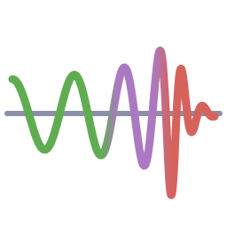

# GravitationalWaveforms.jl


[](https://juliagravitationalwaves.github.io/GravitationalWaveforms.jl/stable/)
[](https://juliagravitationalwaves.github.io/GravitationalWaveforms.jl/dev/)
[](https://github.com/JuliaGravitationalWaves/GravitationalWaveforms.jl/actions/workflows/CI.yml?query=branch%3Amain)
[](https://codecov.io/gh/JuliaGravitationalWaves/GravitationalWaveforms.jl)
[](https://github.com/JuliaTesting/Aqua.jl)

Gravitational-wave waveform models, Float32/Float64-generic and differentiable. Part of the same ecosystem as
[GravitationalWaveData.jl](https://github.com/JuliaGravitationalWaves/GravitationalWaveData.jl) (`gwpy`-equivalent data toolkit) and
[GravitationalWaveBayes.jl](https://github.com/JuliaGravitationalWaves/GravitationalWaveBayes.jl) (GPU-native Bayesian parameter estimation).
Dependency direction is one-way: `GravitationalWaveData` <- `GravitationalWaveforms` <- `GravitationalWaveBayes`.

## Installation

```julia
using Pkg
Pkg.add("GravitationalWaveforms")
```

## Models

| model | what |
|---|---|
| `IMRPhenomD`, `IMRPhenomXAS` | aligned-spin (2,2) inspiral-merger-ringdown, frequency domain (ports of LALSimulation) |
| `IMRPhenomXHM` | aligned-spin higher modes (2,2), (2,1), (3,3), (3,2), (4,4) |
| `IMRPhenomXP`, `IMRPhenomXPHM` | precessing (NNLO or MSA Euler angles), dominant mode / with higher modes |
| `TaylorF2`, `TaylorT3` | post-Newtonian inspirals (frequency / time domain) |
| `SEOBNRv5HM`, `SEOBNRv5PHM` | SEOBNRv5 aligned-spin higher modes / precessing, frequency domain (ports of pyseobnr 0.3.7) |
| `SEOBNRv5AlignedSpinF2`, `SEOBNRv5IMRAlignedSpinF2` | SEOBNRv5 (2,2) from a post-adiabatic table via the SPA: inspiral only / inspiral-merger-ringdown |
| `ODEToy`, `AlignedSpinPNHam`, `AlignedSpinPNHamF2`, `PrecessingSpinPNHam`, `SEOBNRv5AlignedSpin` | the ODE / Hamiltonian ladder the SEOBNR models were built up through (RK4 dynamics, Enzyme and KernelAbstractions tested) |
| `SineGaussian` | sine-Gaussian burst (not a compact-binary model) |

`Phi`/`Ampl` (frequency-domain phase and amplitude), `hphc` (polarizations) and `h_lm` (modes) are
the common entry points; the scalar `_coeffs`/`_scalar` cores they wrap are what GravitationalWaveBayes.jl's GPU
kernels call.

## Documentation

A `Documenter.jl` site lives under `docs/`: nine narrative tutorials (one per waveform model, plus
one on the collocation-point coefficient-fitting technique `IMRPhenomXAS`/`IMRPhenomXHM` use,
`docs/literate/*.jl`), a [Conventions](docs/CONVENTIONS.md) page (units, sign conventions, the
`m1 >= m2` labeling rule, the `t <= 0` time-domain convention), and an auto-generated API
reference. Build it locally with:

```julia
julia --project=docs -e 'using Pkg; Pkg.instantiate()'
julia --project=docs docs/make.jl
```

then open `docs/build/index.html`.

`notebooks/` mirrors every tutorial as a Jupyter notebook (`notebooks/*.ipynb`, regenerate with
`julia --project=docs notebooks/generate.jl`), plus two interactive `Pluto.jl` notebooks under
`notebooks/pluto/` (a waveform-parameter explorer across all 5 frequency-domain models, and a
precession explorer) -- see [notebooks/README.md](notebooks/README.md).

## License

GPL-3.0-or-later. Parts of the package are ports of pySEOBNR, LALSuite and ripple, see [NOTICE.md](NOTICE.md).
